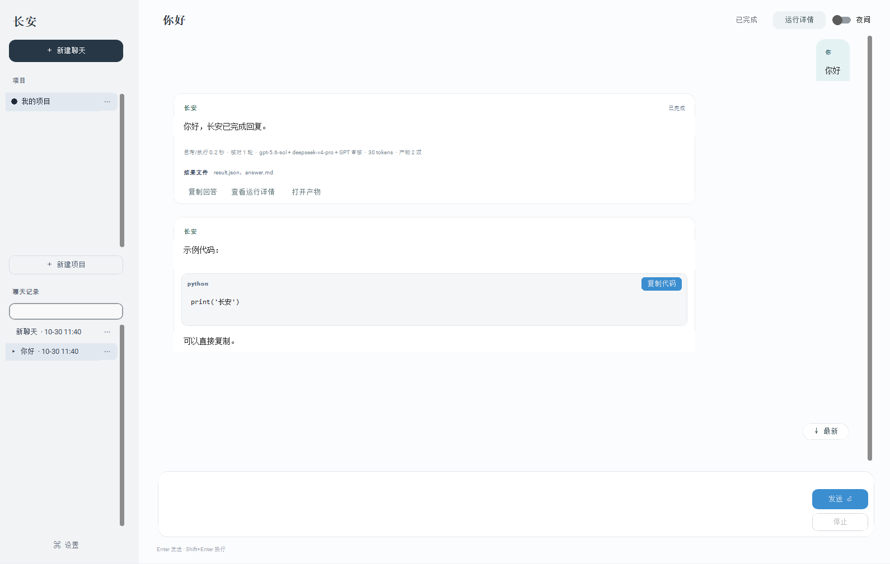
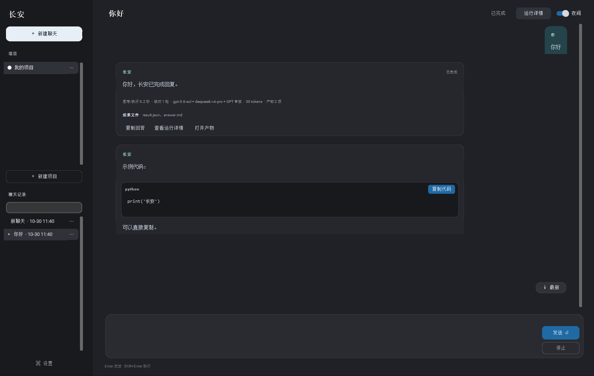

# 我做了一个桌面 Agent「长安」：GPT 分析、DeepSeek 执行、Claude 核验

　　假设你让一个 AI 修改项目文件，它很快回复：“已完成，测试通过。”但文件到底改了没有？所谓“测试通过”，是工具真的运行过，还是模型根据上下文推测出来的？如果做到一半断网，重新打开软件后，能不能从原来的位置继续？这些问题，也是我做“长安”这个项目时逐渐开始重视的事情。

　　最初的想法很直接：做一个 Windows 桌面助手，让 GPT 先分析并列出目标，DeepSeek 负责执行，再由 GPT 核对。后来，我把优先核验模型改成了 Claude，并保留 GPT 作为备用。随着功能增加，我发现模型分工只是起点。工具有没有真正执行、文件有没有可靠保存、中断后会不会重复操作，才决定这个助手是否值得在日常项目里使用。

　　这篇文章分享长安目前的设计、实现和踩坑经历。项目使用 AI 辅助开发，当前仍是个人桌面项目；文中会区分已实现的功能、通过的测试和仍然存在的限制。

　　项目地址：<https://github.com/SHIYANZHONGXIU/ChangAn-agent>

## 一、长安目前能做什么

　　长安使用 Python 和 CustomTkinter 编写，主要面向 Windows 本地项目。使用时，先选择项目文件夹，再在项目下创建聊天，提交任务。目前它具备几类能力：

　　**Windows 桌面应用**：提供 64 位独立程序和当前用户安装入口，可选择导入旧数据；源码启动方式继续保留。

　　**项目与聊天管理**：选择本地目录，新建、搜索、重命名、移动和归档聊天，按聊天保存运行记录。

　　**多模型协作**：GPT 分析、DeepSeek 执行、Claude 优先核验，支持配置服务地址、模型和思考强度。

　　**工具执行**：项目文件读写、命令执行、网页读取、浏览器基础操作，以及部分 PDF、Word、Excel 处理；输入框支持粘贴图片、拖入文件和附件预览。

　　**过程与恢复**：运行计时、工具结果记录、检查点、等待队列，以及中断后的阶段恢复；本地长期记忆支持查看来源、编辑、删除和项目隔离。

　　**结果使用**：代码块复制、文本产物预览、文件差异查看和基于备份的恢复。

　　举一个示意任务：“读取项目里的配置文件，补充一个字段，保存为新文件，并检查 JSON 格式。”这类任务需要先读取实际内容，再执行修改和检查，最后报告生成了什么。下面介绍的是处理它所需的工作流程，不是额外完成的一次真实模型演示。

　　*图：测试窗口演示，使用假模型；不作为真实模型 API 调用成功的证据。*

## 二、多模型协作：先明确目标，再根据证据核对

　　长安当前的基本流程是：用户提出需求 → GPT 生成目标与完成条件 → DeepSeek 提出工具动作 → 本地工具执行并返回结果 → 基础检查 → Claude 或 GPT 核验。核验未通过时，把问题和已有结果带入下一轮，直到通过或达到轮次限制。

　　分析阶段的作用，是把“帮我完善一下”转成更明确的目标。例如对于前面的配置任务，完成条件应该包含“读取原文件”“保存指定结果”“JSON 可以解析”，而不只是“给出修改建议”。执行阶段根据真实工具结果推进。核验阶段则检查回答、目标和执行证据是否一致。

　　这里没有“GPT 天然适合规划、DeepSeek 一定最省钱、Claude 一定最准确”的结论。当前分工来自我的使用需求，还没有做严格的模型对照实验。增加分析和核验也会增加请求次数，是否划算要看任务和实际价格。

　　Claude 未填写密钥时直接使用 GPT 核验；Claude 请求不可用时，本次任务后续改用 GPT，避免反复请求失效的服务。用户主动停止和预算超限不属于这类故障，不会因为切换模型而绕过去。

## 三、工具反馈，是“有方案”和“有结果”之间的关键

　　模型负责提出动作，本地程序负责验证和执行，两者需要分开。长安要求执行模型返回包含 `summary`、`actions`、`done` 等字段的结构化内容。程序检查字段类型和动作参数后，再交给工具执行；不接受模型在动作中自行附带的“工具结果”。

　　工具执行完，成功、失败、文件内容或命令输出会反馈给 DeepSeek。模型据此决定继续读取、修改还是结束，而不是提前把整段执行过程编出来。这个循环也设置了上限：默认每轮最多 8 个工具步骤，每步最多 20 个动作。达到限制仍未完成，会把问题带入核验，而不是无限调用。

　　本地基础检查还会检查工具失败，以及新写入 Python、JSON、JSONL、CSV、PDF、Word 和 Excel 文件的部分语法或结构问题。Office 文档会先检查压缩结构与体积；这些检查针对产物格式，不判断代码逻辑或业务事实。但这里也踩过一个边界：读取一个原本存在语法错误的 Python 文件，不应该自动判定本次任务失败。检查应当围绕任务产生的修改，不能把“读取旧文件”误当作“生成新产物”。

　　同样，模型回复格式错误时，程序可以拒绝继续执行；但如果前面已经写过文件，就必须保留那些操作和证据，不能清空状态后盲目重做。

　　多模型核验也仍然会误判。语法正确不等于逻辑正确，核验模型认可不等于外部事实成立。更可靠的结果需要结合具体项目的测试、数据检查和人工判断。

## 四、中断恢复：恢复的不只是聊天文字

　　最初看待恢复功能时，很容易把它理解成“保存聊天，下次接着问”。但对于能执行操作的 Agent，这远远不够。例如文件已经修改，审核请求却因为断网失败。如果重新启动后从分析阶段重跑，可能再次修改文件或执行命令，产生重复副作用。

　　所以长安会保存当前阶段、各轮结果、工具执行状态和已记录的用量。关键阶段包括分析前、执行前、工具执行前后，以及核验前后。恢复时，如果停在核验阶段，就继续核验已有结果；如果核验已经通过、只是最终结果尚未整理完成，就直接完成收尾。

　　最难处理的是“状态不确定”：程序恰好在命令或文件操作进行中退出，工具可能执行了，但完成记录还没有保存。这种情况不能简单当作失败重试。长安会要求用户确认是否重试，即使当前处于 full access 模式，也保留这个确认节点。

　　达到轮次上限仍未通过的任务，可以增加轮次后继续，保留已有执行结果和核验意见。不过，这还不是数据库式的整体事务机制；跨文件、跨磁盘的操作仍存在无法完全自动恢复的边界。

## 五、聊天、产物和文件版本，要一起管理

　　随着项目功能增加，我开始把聊天看成一个包含消息、任务和产物的工作单元。每个聊天独立建目录，按创建时间、聊天编号和名称组织；项目下的聊天进入项目自己的目录。聊天改名或移动时，相关运行记录和附属文件跟随迁移，内部关联也要更新。

　　保存时使用临时文件和原子替换，并保留上一版本备份。读取到损坏 JSON 时，保留损坏文件，再尝试恢复备份，避免用空数据覆盖原来的记录。最终回答也先完整写入磁盘，再进行界面显示。这样关闭窗口时，不会因为动画只播放了一半，就只保存半句话。

　　文件版本管理里也有一个容易忽略的问题：两个不同子目录都可能有 `config.json`。如果只按文件名找备份，就可能恢复错文件。因此版本记录需要匹配完整相对路径，恢复前还要备份当前内容。不过，目前的版本能力主要基于工具写入前的备份。通过终端或外部编辑器进行的所有修改，并不会自动形成完整版本历史；重要项目仍应该配合 Git 和独立备份。

## 六、界面上的“流式输出”，需要说清楚

　　界面设计上，我希望用户先看到回答，需要排查时再查看详细过程。因此主聊天以简短运行状态和最终回答为主，目标、工具结果、重试和核验进入“运行详情”。详情记录的是模型返回内容和工具事件，不意味着能够读取模型未公开的内部思维。

　　这里还要区分两件事：模型请求的流式返回，以及最终回答在界面上的逐字显示。长安的运行详情可以随网络流接收内容；主聊天则在执行和核验结束后展示最终结果，并对部分文本播放逐字显示动画。它并不是在审核完成前，就实时输出已经确认的最终答案。

　　代码块单独展示和复制，保留原始缩进、空行，避免把显示时添加的换行处理混进实际代码。界面还支持运行时间、明暗主题、跳到最新消息和草稿保留。

　　连续提交的任务进入单并发队列。做这一点时，不能直接把当前聊天的所有消息都发给前一个任务，否则后面尚未执行的请求会混入上下文。队列任务需要按自己提交的位置截取历史。这些功能看起来不如增加一个模型入口显眼，但会直接影响日常使用。

　　*图：测试窗口演示，使用假模型；不作为真实模型 API 调用成功的证据。*

## 七、权限和隐私：本地运行，不代表完全隔离

　　长安提供 ask for approve 和 full access 两种模式。前者对文件写入、命令、Excel 修改和浏览器操作等要求确认；后者减少逐次审批，但仍保留路径和常见危险命令检查。命令输出现在限制为标准输出 20 KB、错误输出 10 KB；Windows 下通过 Job Object 在命令结束后清理进程树，并把进程数限制在 64 个。这仍然不是操作系统沙箱，没有 CPU 和内存配额，危险命令过滤也不可能覆盖所有风险。

　　浏览器流量通过本地代理连接：每个目标先解析、校验公网地址，再固定连接到通过检查的 IP；同时限制并发代理连接与单次流量。这样可以降低校验和实际连接之间被 DNS 重绑定切换地址的风险，但不等于完整网络隔离。Full access 下的命令仍可能自行访问网络或启动其他程序。

　　另一个需要说清楚的地方是：“本地桌面 Agent”不等于“离线模型”。聊天和产物主要保存在本地，但模型请求仍会把相关提问、上下文和工具结果发送到用户配置的 API 服务。项目资料是否适合发送，需要结合服务方的数据政策判断。密钥使用 Windows DPAPI 保存，主要解决明文落盘的问题，并不能防住同一用户账户下的所有恶意程序。分享项目时，仍然要排除配置、聊天、日志、备份和运行产物。

　　费用方面支持按输入、输出分别估价，并在请求与重试前检查预算。服务未返回 token 用量时会标明估算；实际账单、失败请求是否计费，以及单次请求造成的超限，仍取决于服务商。

## 八、目前验证到了哪一步

　　截至 2026 年 11 月 3 日，本机离线回归共 161 项，全部通过，无失败、错误或跳过。测试主要使用模拟接口和临时数据，不调用真实模型 API。新增验证包括 Windows 命令进程树清理、命令输出截断、浏览器代理的本机地址阻断、HTTP 请求转发与 HTTPS 隧道、Office/PDF 输入边界和产物结构检查。桌面发行版也在本机隔离数据目录中实际启动、关闭通过，窗口分辨率为 1376×959。

　　**接口行为**：模拟 429 限流、超时、断流、异常流式格式、参数不兼容、请求取消和审核降级。

　　**执行与存储**：工具结果反馈、审批拒绝、任务恢复、保存失败、损坏备份、聊天迁移、文件版本和队列隔离。

　　**实际界面与文件**：使用临时配置和假模型创建真实 Tk 窗口，检查消息、草稿、代码复制与关闭；使用实际临时 PDF、Word、Excel 文件检查读取和修改。

　　准备发布时还遇到过整套测试中的队列等待超时。定位后发现，连续创建和销毁测试窗口留下的 Tk 字体，在后台垃圾回收时触发了窗口线程等待。调整测试清理方式后，两份目录的完整回归通过。这说明单个测试通过，仍不代表整套测试可以稳定运行。

　　这些验证没有调用真实收费模型，也没有在第二台干净 Windows 电脑上完成安装验收；不能据此确认某个账户当前有余额、某个模型别名可以调用，也不能把 161 项测试理解成“161 种真实任务全部成功”。当前发行包未签名，也没有自动更新。

## 九、如何尝试，以及接下来准备做什么

　　现在长安除了 Python 源码版，还提供 Windows x64 独立桌面程序和当前用户安装脚本；安装时可选择导入已有数据。模型服务仍需用户自行配置。浏览器自动化优先使用已有 Playwright Chromium；Windows 上没有该内核时会尝试系统 Microsoft Edge。建议先在临时项目中使用 ask for approve 模式，从读取文件、生成新文件这类容易检查结果的小任务开始。观察运行详情中的真实动作，再逐步用于自己的项目。

　　当前 Claude 接入依赖 OpenAI 兼容接口，不支持 Anthropic 原生 Messages 协议。可用模型、思考参数和收费情况也取决于具体服务，不能只看下拉框中的名称判断是否可用。桌面发行包尚未签名，没有自动更新，也没有第二台干净电脑验收。长安没有多用户云服务或完整办公编辑器；PDF、Word 以内容提取为主，Excel 支持范围读取和单元格修改。审核仍有一部分依赖 Claude 或 GPT 的模型判断，自动化文件检查不能证明结果在业务上正确。

　　接下来我会继续补真实服务的兼容性验证、更多任务专用验证器和干净环境安装测试，再根据实际需求评估自动更新、签名与多人协作。做完这轮开发，我更关心的是：它能不能把“做了什么、成功了什么、哪里还不确定”说明白。对一个会修改文件和执行命令的助手来说，这些信息应该和最终答案一起成为交付的一部分。

　　项目源码已公开，可在 GitHub 查看使用说明、下载代码或反馈问题：<https://github.com/SHIYANZHONGXIU/ChangAn-agent>。仓库目前尚未选择开源许可证，公开源码不等于已经授予自由修改、分发或商用授权。

　　如果你也在做 Agent，最困扰你的是哪一环：模型调用、工具权限、上下文管理，还是任务中断后的恢复？欢迎交流。
